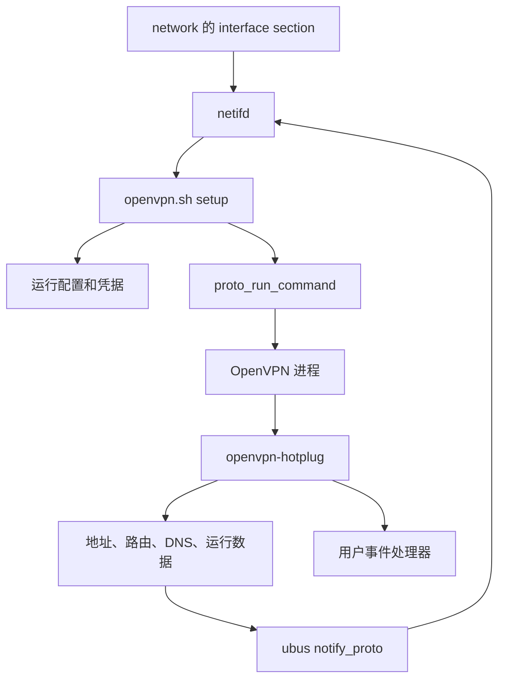

# OpenVPN 与 netifd 集成规格

审核日期：2026-10-26。当前版本：OpenVPN `2.7.7-5`，包含配置、网络生命周期、
晚到回调处理及跨版本 redirect 过滤。本文描述当前实现；原始问题及修复状态见
[审核记录](NETIFD_REVIEW.md)。

已核对 OpenVPN 2.6.19 和 2.7.7 源码。在 OpenWrt 21.02 的 netifd
`2021-10-30-8f82742c`、libubox `2021-05-16-b14c4688` 上完成 native 生命周期验证；
netifd `2026.09.11~06d06c86`、libubox `2026.07.21~e7608b69` 完成 shell API/jshn
验证。新版 C 状态机及其他版本仍需各自验收，不能从共享脚本推断。

## 1. 职责与入口

| 组件 | 职责 | 安装位置 |
| --- | --- | --- |
| [协议脚本](files/lib/netifd/proto/openvpn.sh) | 注册 `openvpn` 协议；生成配置和凭据；请求 netifd 管理进程；renew/teardown | `/lib/netifd/proto/openvpn.sh` |
| [选项表](files/usr/share/openvpn/openvpn.options) | UCI 字段及类型的来源 | `/usr/share/openvpn/openvpn.options` |
| [配置解析器](files/usr/share/openvpn/config.awk) | 一次展开 include/cd、收集回调和模式、过滤托管指令并生成运行快照 | `/usr/share/openvpn/config.awk` |
| [回调入口](files/usr/libexec/openvpn-hotplug) | 将地址、路由、DNS 和运行数据发布给 netifd；分发用户事件 | `/usr/libexec/openvpn-hotplug` |
| [用户事件处理器](files/etc/hotplug.d/openvpn/01-user) | 调用全局用户脚本和 `user_*` 回调 | `/etc/hotplug.d/openvpn/01-user` |
| [全局用户脚本](files/etc/openvpn.user) | 接收 `ACTION`、`INSTANCE` 和原始参数 | `/etc/openvpn.user` |
| [WAN 更新处理器](files/etc/hotplug.d/iface/90-openvpn) | WAN 地址/路由更新时请求依赖实例比较实际路径 | `/etc/hotplug.d/iface/90-openvpn` |
| [迁移脚本](files/etc/uci-defaults/60_openvpn_migrate.sh) | 将旧 `openvpn` UCI 包迁移到 `network` | `/etc/uci-defaults/60_openvpn_migrate.sh` |

[Makefile](Makefile) 安装 shell 协议脚本。仓库中的
`files/lib/netifd/proto/openvpn.uc` **没有安装，也不是当前生效入口**。
安装的 `/usr/share/openvpn/*.uc` 是独立调试/示例脚本，不参与默认流程。

一个 `network` 的 `interface` section 对应一个 OpenVPN 进程和一组运行文件。
netifd 管理进程及系统地址/路由/DNS，OpenVPN 管理传输、TLS、认证和 TUN/TAP。
防火墙、NAT、业务策略路由、客户端证书/账号管理由消费模块负责。

## 2. 配置契约

配置位于 `/etc/config/network`，section 为 `config interface '<name>'`，
`proto='openvpn'`。OpenVPN 的传输协议另用 `ovpnproto`，避免与 netifd 的
`proto` 字段冲突。自动启动由 netifd 的 `auto` 控制。
集成原则是由 netifd 接管系统网络配置，其他能力尽量保持 OpenVPN 原生语义；
冲突的网络/进程/回调指令在运行快照中过滤，再由托管参数覆盖。
运行依赖包含 iproute2 的 `ip` 和 BusyBox `flock`。

| 字段 | 当前语义/默认值 |
| --- | --- |
| `auto` | netifd 通用字段，默认允许自动启动；迁移生成的 section 固定写 `0` |
| `config` | 可选原生配置入口；当前以其所在目录作为初始工作目录 |
| `config_version` | 可选配置修订标识；修改它并 reload network 会触发完整 setup，重新读取导入配置和 include；不生成原生指令 |
| `dev` / `dev_type` | 原生 TUN/TAP 设备名和类型；无导入配置且名称不能推断类型时默认 TUN |
| `ovpnproto` | 转为原生 `proto`，如 `udp`、`tcp-client`、`tcp-server` |
| `username` / `password` | 任一非空时生成本实例的 `auth-user-pass` 文件 |
| `cert_password` | 非空时生成本实例的 `askpass` 文件 |
| `auth_user_pass` / `askpass` | 没有生成对应凭据时使用指定文件路径 |
| `ipv6` | 默认 `1`；控制隧道内 IPv6 地址和路由；不禁用 IPv6 传输，IPv6 外层端点仍受保护 |
| `defaultroute` | 存在原生 `remote` 时默认 `1`；没有 `remote` 时回调环境强制设为 `0` |
| `tunlink` | 可选外层逻辑接口；指定时端点路径查询绑定该接口的 L3 设备，否则从现有外部路径发现 |
| `metric` | netifd 的接口路由 metric；还作为手工端点保护路由的 metric |
| `mtu` | netifd 接口 MTU，优先于原生 tun_mtu；明确匹配该设备名的 network device section 的 mtu 优先级更高 |
| `peerdns` | netifd 通用字段；是否把协议 DNS 合入系统解析配置，由 netifd 控制 |
| `allow_deprecated` | 默认 `0`；控制选项表中 `:d` 字段的生成，不过滤导入文件中的同名指令 |
| `script_security` | 兼容接收该字段；托管模式固定 `3`，保证集成与自定义回调执行，导入或 UCI 的较低值被覆盖 |
| `tun_max_mtu` | 旧输入名，仅在 `tun_mtu_max` 缺省时作为回退 |
| `auth_gen_token_lifetime` | 旧输入名；与 `auth_gen_token=1` 组合转换为原生 token lifetime；只有启用开关时不附加 lifetime |

`option_builder add` 将字段注册给 netifd，用于转换 UCI 和判断配置变化。
布尔选项只在值为 `1` 时生成；普通字符串保留原生多参数语法；文件参数尝试
加引号；数组选项逐项生成。`data_ciphers/tls_cipher/tls_ciphersuites/tls_groups`
合成一条以冒号分隔的值，`push` 每项作为一个完整参数处理。

UCI `route` 只注册为列表，兼容单字符串，避免同时按两种类型生成。
文件类参数不再用统一 `-f` 静默丢弃，目录、输出文件、回调命令和 `dh none`
保留到原生配置，由 OpenVPN 结合最终 `cd` 验证。主配置因需要读取而单独检查
为普通文件。任意原生配置不是经过完整语义验证的受限配置语言。
`user/group/chroot` 与当前需要权限及宿主 IPC 的集成回调不兼容，在 UCI 和导入
配置生成的快照中统一注释屏蔽，不拒绝整个配置；日志和状态仅报告被屏蔽的选项名。

## 3. setup 与覆盖顺序

协议注册声明 `available=1`、`no_device=1`、`lasterror=1`、`renew_handler=1`。
netifd 不要求预先存在底层设备，TUN/TAP 在 OpenVPN 打开后通过回调关联。

setup 的当前顺序：

1. 创建 0700 私有 staging 目录，读取 JSON，生成初始目录、status、syslog 和 UCI 参数。
2. 单次遍历按原生顺序展开主配置和 include，维护进程级 cd 状态，同时提取模式和回调、
   过滤托管指令，生成一个运行快照。include 返回后不会恢复旧 cd。
3. 检查引用文件可读、目录存在、循环/深度上限、引号和内嵌块边界，私有写入凭据。
   完成准备前的失败保留上次快照，返回结构化错误且不启动进程。
4. 生成本轮 UUID，清理上次拥有的端点路由并初始化运行状态；将完整配置和凭据移入
   固定运行路径，最后通过 `proto_run_command` 请求 netifd 执行前台 OpenVPN。
   发布或启动失败清理本轮文件和准备状态，退出时清理 staging。

配置解析器识别引号、转义、行尾注释、可选 `--` 前缀、BOM 和
`<connection>`，证书/密钥等内嵌内容保持不透明。配置展开、模式识别和过滤共用
一次编译；include 超过 10 层也按 CONFIG_CYCLE 拒绝。相对路径不词法折叠 `..`，
以保留穿过符号链接时的文件系统语义。其余选项语义仍交给 OpenVPN 校验。

实际加载顺序是：

1. 选项表顺序生成 UCI 参数；`config` 在其位置展开原生配置及 include。
2. 追加显式 UCI `setenv user_*`；这些值优先于导入的同名回调。
3. 为有效的原生回调生成 user_* 命令及安全事件包装；已有明确 user_* 时保留其值。
4. 进程命令行中的 netifd 托管覆盖项。
5. 命令行最后的 `askpass/auth-user-pass` 文件参数。

因此，**普通 UCI 参数不保证整体覆盖导入配置**。单值、多值和即时执行指令的
行为还取决于 OpenVPN 本身；显式 UCI 回调和托管凭据则有专门的优先级安排。

固定覆盖项包括 `INTERFACE/OPENVPN_GENERATION`、`script-security 3`、`ifconfig-noexec`、
`route-noexec`、四个生命周期回调以及 `persist-tun/persist-key/up-restart`。
导入的 `daemon` 被过滤，以保留 netifd 直接子进程管理。
存在 `remote` 时还固定包装 `ipchange`；仅在 `defaultroute=1` 时添加
`redirect-gateway def1 ipv6` 和 `NETIFD_REDIRECT_GATEWAY=1` 兼容标记，实际路由由回调生成。
客户端导入的 redirect-gateway/redirect-private 统一屏蔽。关闭默认路由时，
在 `--config` 之前添加 `pull-filter ignore redirect-gateway/redirect-private`，
利用原生 first-match 语义优先于导入的 accept 规则，避免服务器推送的 IPv6
自动分拆路由绕过 netifd 默认路由开关；普通显式路由与其余 pull-filter 行为保留。
配置保存在文件中，避免消费 netifd 的 64 项进程参数数组限制。

| 指令类别 | 覆盖原则 |
| --- | --- |
| 地址、路由执行 | 固定 noexec，地址和隧道路由经 netifd API 发布 |
| 默认路由 | netifd 的 defaultroute、接口 metric 和路由表控制实际系统路由 |
| 生命周期、前台运行 | 固定托管回调及重连参数，过滤 daemon；原用户回调通过 user_* 保留 |
| user/group/chroot | 屏蔽选项，保持回调所需权限和宿主 IPC 可用 |
| script-security | 固定 3，保证托管与自定义脚本可执行；不作为禁止用户脚本的开关 |
| TLS、认证、数据通道及其他原生参数 | 尽量保留原生行为；不以统一文件存在性检查删掉配置 |

## 4. 回调与状态发布

OpenVPN 负责导出回调环境，回调根据 `script_type` 分发。
`INTERFACE` 必须是 netifd 逻辑接口名，`dev` 才是实际设备名。

| 事件 | 当前处理 |
| --- | --- |
| `up` | 初始化更新；设置 MTU；生成地址/路由/DNS；保护远端端点；发布 link-up 和运行数据；再调用用户处理器 |
| `route-up` | 记录与用户分发，不再次发布网络配置 |
| `down` | 普通断线发布 link-down，清除协议 IP/DNS，删除已拥有端点路由；再分发用户事件。teardown 期间跳过已被 netifd 接管的 link-down |
| `route-pre-down` | 记录与用户分发 |
| `ipchange` | 客户端重建当前端点保护，再清理旧端点；失败请求 netifd teardown；继续分发用户事件 |
| `user-pass-verify` | 认证处理器分发；接受 `auth-user-pass-verify` 别名 |
| `tls-verify`、服务端连接/地址事件 | 按有效 client/server 模式生成包装并分发 |
| `tls-crypt-v2-verify` | 保留原生执行命令；OpenVPN 使用的新环境不能依赖这里的 `INTERFACE/user_*` |
| `prepare` | setup 内部入口；清理遗留路由、重置 stopping、WAN 缓存和依赖记录 |
| `cleanup` | teardown 显式调用；标记 stopping，按独立运行状态清理端点路由，不依赖 ubus data |
| `wan-update` / `renew` | 内部路径比较及重连请求状态更新，不分发用户事件 |

更新使用 netifd shell API，经 ubus `network.interface notify_proto` 发送：

- `proto_init_update "$dev" 1`：关联 L3 设备并报告 link-up。
- `proto_add_ipv4_address/ipv6_address`：提交协议地址；IPv4 P2P 传入 peer，subnet 保留 netmask。
- `proto_add_ipv4_route/ipv6_route`：提交协议路由。
- `proto_add_dns_server/dns_search`：提交协议 DNS。
- `proto_add_data`：提交 `daemon_pid` 和 `ifname`。端点路由所有权存于独立易失状态。
- `proto_send_update "$INTERFACE"`：发送完整协议更新，默认 `keep=false`。

消费 netifd 负责把这些数据应用到内核、接口状态和解析配置中。
`notify_proto` 成功只表示通知被处理，不能证明每条内核路由都添加成功；
消费 netifd 仍可能把个别地址/路由记录为 failed。

独立使用 `network.interface.<name> set_data` 写入 `data.openvpn`，不重发 IP 配置。
字段包括 phase、role、generation、endpoint4/6、uplink4/6、ignored_options、
last_error、mtu/mtu_source、reconnect_reason 和 updated。phase 记录 starting、
tunnel-up、reconnecting、renew-requested、stopping 或 failed；这是回调阶段，
不代表 TLS CONNECTED。不接管用户的 management socket，set_data 失败不阻止连接。

MTU 顺序为：**匹配设备名的 network device.mtu > network interface.mtu >
OpenVPN tun_mtu**，每次 up 都按此应用。读取明确 UCI 配置，避免把旧设备的当前
MTU 当成配置；读取失败或 MTU 无效时 up 失败。仅动态 API 设置、未落入上述字段的
MTU 没有“明确配置”标识，当前不从 device status 推断其来源。

setup 的 UUID 通过 OPENVPN_GENERATION 传给回调；旧代 up/安全回调拒绝，旧代 down
忽略，防止旧进程污染新代运行态。实例锁内再次检查 up/down/ipchange 的 UUID。
密码认证、TLS 校验和服务端安全事件在分发用户处理器期间持有实例共享锁，
拿锁后再次校验 UUID 和 stopping；prepare/cleanup 使用独占锁，因此不能在
已进入安全处理器时切换实例代次或 stopping。调用用户处理器的子进程关闭锁
描述符，父进程持锁等待同步处理器返回，后台进程不继续占锁。

OpenVPN 2.6.19 在新建 TUN/TAP 的 `up` 前初始化并导出路由列表，
不能因使用 `up` 就认定路由变量尚不可用。TLS client 的连接状态、TUN/TAP
存在状态和 netifd 的 `up` 也不是同一指标；服务端 `up` 不表示已有客户端连接。

## 5. 路由和 DNS

OpenVPN 因 `ifconfig-noexec/route-noexec` 不执行常规地址、路由配置。
回调读取 `ifconfig_*`、`route_network_N/route_netmask_N/route_gateway_N`、
`route_ipv6_*` 和 `foreign_option_N`，转换成 netifd 消息。

当前实现仅在 `DEFAULTROUTE=1` 且 redirect 生效时去掉固定集合中的默认/分拆默认路由，
并在允许默认路由时生成
IPv4 `0.0.0.0/0` 和可用的 IPv6 `::/0`。
OpenVPN 2.7 导出 `route_redirect_gateway_ipv4/ipv6`，优先使用原生值判断来源；
OpenVPN 2.6 没有该状态，由 provider 在自行添加 redirect 时设置
`NETIFD_REDIRECT_GATEWAY` 作为兼容标记。未启用 redirect 时，与分拆前缀相同的
显式 ULA/默认路由仍发布给 netifd。redirect 启用时，同前缀的显式路由与自动生成
路由仍无法从原生环境精确区分，属于已知 F07 语义限制。
按 netifd 接管默认路由的设计，原生 `def1` 转为 netifd 的默认路由；实际选路受接口 metric、
netifd 的 `ip4table/ip6table` 和外部策略控制。不能仅凭 `defaultroute=1`
推导所有流量必经 VPN，也没有自动生成防火墙阻断策略。

在 `up/ipchange` 使用实际 `trusted_ip/trusted_ip6` 查询外层路径并记录 WAN 依赖，
仅 `DEFAULTROUTE=1` 时创建端点保护路由，再发布 VPN 网络状态。优先使用显式 `tunlink` 或上次外部设备；
首次从现有路径发现，若指向自身隧道则选择外部默认路由接口并限定输出设备重查。
查到外部逻辑接口后，以空 host 注册 netifd WAN 依赖，避免 netifd 另建不受本包
清理控制的 host route。WAN 断线由 netifd teardown 当前进程；同接口地址/网关
更新由 iface hotplug 请求路径比较：相同路径不重连，只有网关改变时刷新保护路由，
源地址/设备改变或路径不可用时 renew。同一轮 up 前合并重复请求，下一次 up 清除
pending。共享路由冲突或刷新失败时回滚原路由及路径记录，回退 renew；恢复失败请求 teardown。
比较使用当前主路由表中匹配端点的外部路由，排除自身拥有的保护路由，避免旧主机
路由掩盖网关变化；没有扩展 fwmark、VRF 和完整策略路由上下文。

所有权存储为 `family|target|gateway|device|metric`，不存储可执行命令。
每实例 flock 串行化本实例运行态；全局 flock 仅串行化路由所有权及内核路由修改，
ubus 路径查询在全局锁外。同路径/metric 的已有管理员路由不认领，
多个托管实例共享已拥有路由，最后一个所有者负责删除。端点变化先保护新路径，
再清理旧路径；发布失败返回非零并回滚本次取得的路由，删除失败保留记录供重试。
状态发布失败即使失去 ubus 数据也能清理。不能把这些措施等同于掉电事务或完备的
多 WAN 策略路由支持；目标设备的路由表、规则和并发外部写入仍需验收。
IPv6 的 metric 0 按 Linux 的实际值 1024 记录，以正确复用和清理端点路由。

端点保护路由由本 provider 直接维护并向 netifd 注册 WAN 存活依赖；DCO 服务端
逐客户端 iroute 和网段外地址所需的分流路由由 OpenVPN/DCO 数据面维护。
这些路由不通过 netifd 的协议 route 列表配置；DCO 路由的清理和设备下线行为
属于原生数据面生命周期，仍需目标设备验收。netifd 继续负责普通地址、默认路由、
策略/业务路由和 DNS。

DNS 接受 `dhcp-option DNS/DNS6`，搜索域接受 `DOMAIN*`。
消费 netifd 的 `peerdns=0` 会阻止协议 DNS 合入系统解析文件；即使回调
仍上报 DNS，也不能认定它忽略了 `peerdns`。
新式 OpenVPN `dns` 的高级优先级、分域、传输等语义没有在此独立实现。

## 6. 进程、重连与退出

OpenVPN 是 netifd 的 `proto_task`，不是单独的 procd service。
setup 请求启动后不直接将接口设为 up；首次 `up` 回调负责状态发布。
进程退出由 netifd 监控，并进入协议清理/后续状态处理。

renew 通过 `proto_kill_command` 向当前进程发 `SIGUSR1`，不重新序列化 UCI，
也不等价于重新启动 netifd 接口。修改原生文件/include 后，应变更接口的
`config_version` 并执行 `ubus call network reload`，或完整 ifdown/ifup；没有自动文件监控。
固定 `persist-tun` 保留设备，同时固定 `up-restart`，使软重连也调用 `up/down`。
普通 down 向当前 netifd 发布 link-down；该版本的 IFPEV_LINK_LOST 清除协议
地址、路由、DNS 和接口 data，把接口恢复到 setup，保留 proto_task 继续重试。
WAN 依赖失效的分支会额外触发 teardown，两种路径不能混为一谈。

teardown 依次请求 SIGTERM、调用 cleanup 标记 stopping 并清理端点路由、删除
实例配置/凭据文件。状态目录与锁不在配置通配清理范围内；失败删除的所有权仍可
在后续 prepare 重试，stopping 防止晚到的 up/ipchange 重新添加路由，也拒绝
晚到安全回调执行用户代码。晚到 down 仍分发用户通知，但不改写阶段、路由或
up 标记，保留 stopping 状态和 cleanup 的失败重试记录。最终下线
由 netifd 状态机完成，不再发送 teardown 状态会拒绝的冗余 link 更新。

## 7. 回调扩展及信任边界

安全事件逐个在独立子 shell 中执行 `/etc/hotplug.d/openvpn/*`，保留非零返回码。
只有密码认证事件把 `2` 作为 deferred；其他事件中的 `2` 仍是非零结果。
密码认证中明确拒绝优先于 deferred。缺少事件上下文或安全处理器返回失败。
普通生命周期事件继续使用系统 `hotplug-call`，不具备同样的全部状态聚合契约。

`01-user` 先以清空环境方式执行 `/etc/openvpn.user`，只显式给出 `ACTION`、
`INSTANCE` 和原始参数；再根据事件选择 `user_up/user_tls_verify` 等命令。
传给用户命令的回调参数保留原始边界。
全局用户脚本的返回码仍存在问题，见审核记录。固定 `script-security 3` 是
集成要求；不再根据导入/UCI 较低级别跳过自定义回调包装。

原生导入配置属于管理员信任输入。AWK 不把配置当 shell 求值，
但仍允许 OpenVPN 按配置语义执行管理员提供的回调。这里不是不可信上传文件的
安全隔离层。`user/group/chroot` 被托管模式屏蔽，原始用户配置文件不会被改写。

## 8. 文件、迁移与消费方

| 文件类别 | 路径与生命周期 |
| --- | --- |
| 主运行配置 | `/var/run/openvpn.<interface>.conf` |
| 导入内容 | 已展开到主运行配置，不再发布单独 include 副本 |
| 凭据 | `.auth`、`.pass`；正常新建使用私有权限 |
| OpenVPN 状态 | `.status`；内容格式由 OpenVPN `status_version` 决定 |
| 端点及状态 | `/var/run/openvpn-<interface>/`，目录 0700；routes、dependencies、path4/6、uplink4/6、generation、phase、up、stopping 等 |
| 修改锁 | `/var/lock/openvpn-<interface>.lock` 和 `/var/lock/openvpn-netifd.lock`；用户事件处理前释放 |
| 私有 staging | `/var/run/openvpn.<interface>.build.XXXXXX/`，保存待发布配置、元数据及凭据，正常退出清理 |
| 用户资料 | `/etc/openvpn/`；由 keep.d 保留 |
| 全局用户脚本 | `/etc/openvpn.user`；声明为 conffile |

当前 OpenWrt 的 `/var/run` 属于易失运行态，正常启停不会主动写回 `network`。
迁移是显式持久化行为：原生 UCI export 规范化读取，保留列表和多行值，
`proto` 改名 `ovpnproto`，删除旧启停字段并写 `auto=0`；已有同名网络段跳过。
在原目录构造并校验候选网络文件，保留原权限，原子替换后归档旧包。
归档失败尝试回滚，回滚失败保留备份。该过程没有跨进程锁，也不是两文件的
掉电原子事务；升级和并发写入验证仍需单独进行。

当前产品消费方核对：

- 手动客户端写 `ovpnproto`、`client`、`remote`、显式设备名、
  `route_nopull=1`、`defaultroute=1`、`peerdns=0`、`delegate=0` 和接口 metric；
  它抽取结构化字段，不把上传原文直接交给 provider。
- 产品服务端使用 `topology=subnet`、`server`、`tls_server`、status v3、
  证书路径和 `push/data_ciphers` 列表。当前版本化 adapter 提供设备名、
  `dh none`、`client-config-dir`、`ccd-exclusive` 及可选密码认证回调。
  adapter 路径变化用于触发 netifd 配置变更；旧版本依靠它规避目录和 `dh none` 问题；修复后仍保持 adapter 兼容。
- 更改 provider 的回调、优先级或路由策略时，必须同时验证这两个消费方。

## 9. 验收边界

永久隔离回归入口见 [tests/README.md](tests/README.md)。2.6.19 消费树的
218 项检查通过，
包含真实 ubus/netifd C 生命周期（dummy 系统后端）及 shell/JSON 转换回归。
已完成的包编译与隔离用例不能替代目标内核、TLS/DCO 和设备运行验收。
本次审核证据与未覆盖项见 [审核记录](NETIFD_REVIEW.md)。
